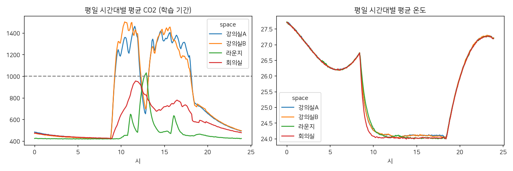

# 과제 2. 데이터 진단서

> 측정 조건: 데이터 합성(자체 생성기) · 학습 2026-08-31 ~ 2026-09-20 · 검증 2026-09-21 ~ 2026-09-27 · 시험 2026-09-28 ~ 2026-10-04 · 간격 5min · 과거 120분 → 미래 60분 · team4 (aarch64) · 2026-10-20 11:10

## 1. 정제 규칙

| 상황 | 처리 | 이유 |
|---|---|---|
| 물리적으로 불가능한 값 | 결측으로 바꿈 (CO2 (300, 5000), 온도 (-10, 50), 습도 (5, 100)) | 0ppm·65535·-40℃는 센서·통신 오류. 그대로 두면 평균과 학습을 크게 왜곡 |
| 짧은 결측 (≤15분) | 선형 보간 | CO2·온도는 몇 분 안에 급변하지 않아 보간 오차가 잡음 수준 |
| 긴 결측 (>15분) | 결측 유지, 그 구간을 지나는 학습·평가 창은 버림 | 수 시간을 지어내면 모델이 가짜 패턴을 배움 |
| 센서마다 다른 기록 주기 | 5min 평균으로 맞춤 | 아래 '분석 간격' 참고 |

**제거된 이상값**: co2 258건, temperature 93건, humidity 0건

**공간·항목별 결측률(1분 기준, %)**

| space   |   co2 |   temperature |   humidity |
|:--------|------:|--------------:|-----------:|
| 강의실A    |  4.57 |          4.46 |       4.41 |
| 강의실B    |  4.38 |          4.31 |       4.26 |
| 라운지     |  4.61 |          4.56 |       4.51 |
| 회의실     |  4.49 |          4.4  |       4.37 |

## 2. 분석 간격

5min으로 모은다. 1분 값은 측정 잡음(CO2 ±8ppm)이 커서 변화량이 묻히고, 15분 이상으로 모으면 수업 시작 직후 오르는 모습(아래 반응 시간 참고)이 뭉개진다. 60분 예측이 12칸이 되어 모델 출력 크기도 적당하다.

## 3. 학습·검증·시험 분할

| 구간 | 기간 |
|---|---|
| train | 2026-08-31 ~ 2026-09-20 |
| val | 2026-09-21 ~ 2026-09-27 |
| test | 2026-09-28 ~ 2026-10-04 |

시간 순서대로 자른다. 무작위로 섞으면 같은 수업 시간의 바로 앞뒤 5분이 학습과 시험에 나뉘어 들어가 모델이 '정답 바로 옆 값'을 외워 성능이 부풀려진다. 정규화 평균·표준편차는 학습 기간으로만 계산한다. 시험 기간(마지막 주)에는 고장이 심어져 있으므로, 예측 평가에서는 고장 구간과 그 뒤 60분을 뺀다.

## 4. 평일 시간대별 패턴

공간별 시간대 평균 CO2 (ppm)

|   ts |   강의실A |   강의실B |   라운지 |   회의실 |
|-----:|-------:|-------:|------:|------:|
|  7   |    428 |    428 |   422 |   431 |
|  9   |    642 |    635 |   422 |   435 |
| 10.5 |   1359 |   1498 |   452 |   710 |
| 12   |   1261 |   1318 |   547 |   945 |
| 12.5 |    786 |    858 |   934 |   859 |
| 13.5 |   1237 |   1240 |   641 |   728 |
| 15   |   1329 |   1390 |   486 |   717 |
| 17   |   1277 |   1169 |   474 |   729 |
| 18.5 |    754 |    732 |   451 |   577 |
| 20   |    656 |    665 |   447 |   572 |

## 5. 일정 변화 뒤 CO2 반응

일정 시작 시점보다 CO2가 100ppm 오를 때까지 걸린 시간

|                |   일정 수 |   반응 시간 중앙값(분) |   60분 안에 반응 없음(%) |
|:---------------|-------:|---------------:|------------------:|
| ('강의실A', '수업') |     46 |            2   |               0   |
| ('강의실B', '수업') |     50 |            2.5 |               0   |
| ('라운지', '휴식')  |     72 |            7   |               2.7 |
| ('회의실', '회의')  |     55 |           12   |              15.4 |

**일정과 실제가 어긋난 날** (일정이 있는데 최고 CO2 600 미만, 또는 일정이 없는데 800 초과)

없음

반응 없음 비율은 노쇼·결석·조기 종료를, 반응 시간은 '일정 시작 시각'을 특징으로 쓸 때 몇 칸 뒤부터 효과가 나타나는지를 알려 준다.

## 6. 기준선

→ [baselines.md](baselines.md)
