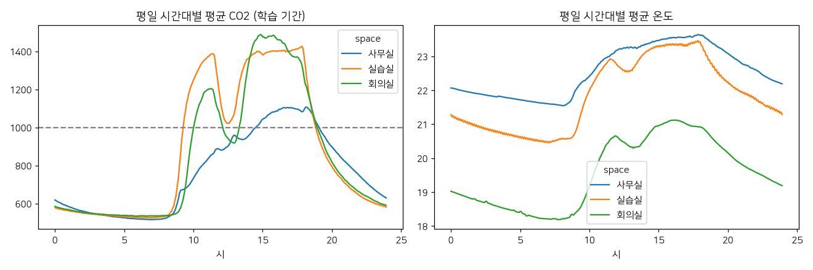

# 과제 2. 데이터 진단서

> 측정 조건: 데이터 실데이터(InfluxDB, 추정 시간표) · 학습 2025-09-03 ~ 2026-08-31 · 검증 2026-09-01 ~ 2026-09-30 · 시험 2026-10-01 ~ 2026-10-20 · 간격 5min · 과거 120분 → 미래 60분 · team4 (aarch64) · 2026-10-20 15:35

## 1. 정제 규칙

| 상황 | 처리 | 이유 |
|---|---|---|
| 물리적으로 불가능한 값 | 결측으로 바꿈 (CO2 (300, 5000), 온도 (-10, 50), 습도 (5, 100)) | 0ppm·65535·-40℃는 센서·통신 오류. 그대로 두면 평균과 학습을 크게 왜곡 |
| 짧은 결측 (≤15분) | 선형 보간 | CO2·온도는 몇 분 안에 급변하지 않아 보간 오차가 잡음 수준 |
| 긴 결측 (>15분) | 결측 유지, 그 구간을 지나는 학습·평가 창은 버림 | 수 시간을 지어내면 모델이 가짜 패턴을 배움 |
| 센서마다 다른 기록 주기 | 5min 평균으로 맞춤 | 아래 '분석 간격' 참고 |

**제거된 이상값**: co2 472건, temperature 0건, humidity 1건

**공간·항목별 결측률(1분 기준, %)**

| space   |   co2 |   temperature |   humidity |
|:--------|------:|--------------:|-----------:|
| 사무실     | 19.08 |         17.55 |      17.55 |
| 실습실     | 12.15 |         12.04 |      12.04 |
| 회의실     | 90.47 |         90.54 |      90.54 |

## 2. 분석 간격

5min으로 모은다. 1분 값은 측정 잡음(CO2 ±8ppm)이 커서 변화량이 묻히고, 15분 이상으로 모으면 수업 시작 직후 오르는 모습(아래 반응 시간 참고)이 뭉개진다. 60분 예측이 12칸이 되어 모델 출력 크기도 적당하다.

## 3. 학습·검증·시험 분할

| 구간 | 기간 |
|---|---|
| train | 2025-09-03 ~ 2026-08-31 |
| val | 2026-09-01 ~ 2026-09-30 |
| test | 2026-10-01 ~ 2026-10-20 |

시간 순서대로 자른다. 무작위로 섞으면 같은 수업 시간의 바로 앞뒤 5분이 학습과 시험에 나뉘어 들어가 모델이 '정답 바로 옆 값'을 외워 성능이 부풀려진다. 정규화 평균·표준편차는 학습 기간으로만 계산한다. 시험 기간(마지막 주)에는 고장이 심어져 있으므로, 예측 평가에서는 고장 구간과 그 뒤 60분을 뺀다.

## 4. 평일 시간대별 패턴

공간별 시간대 평균 CO2 (ppm)

|   ts |   사무실 |   실습실 |   회의실 |
|-----:|------:|------:|------:|
|  7   |   515 |   528 |   534 |
|  9   |   655 |   806 |   566 |
| 10.5 |   789 |  1325 |  1132 |
| 12   |   880 |  1116 |  1034 |
| 12.5 |   901 |  1022 |   941 |
| 13.5 |   936 |  1289 |  1082 |
| 15   |  1042 |  1381 |  1475 |
| 17   |  1103 |  1400 |  1385 |
| 18.5 |  1079 |  1108 |  1117 |
| 20   |   898 |   795 |   818 |

## 5. 일정 변화 뒤 CO2 반응

일정 시작 시점보다 CO2가 100ppm 오를 때까지 걸린 시간

|                  |   일정 수 |   반응 시간 중앙값(분) |   60분 안에 반응 없음(%) |
|:-----------------|-------:|---------------:|------------------:|
| ('사무실', '추정 사용') |    113 |             26 |              53.3 |
| ('실습실', '추정 사용') |    256 |              4 |               9.2 |
| ('회의실', '추정 사용') |    136 |             18 |              46.5 |

**일정과 실제가 어긋난 날** (일정이 있는데 최고 CO2 600 미만, 또는 일정이 없는데 800 초과)

|                                      |   max_co2 |   n_sched |
|:-------------------------------------|----------:|----------:|
| ('사무실', datetime.date(2025, 12, 25)) |       533 |         1 |
| ('사무실', datetime.date(2026, 1, 1))   |       496 |         1 |
| ('사무실', datetime.date(2026, 1, 23))  |       489 |         1 |
| ('사무실', datetime.date(2026, 8, 17))  |       538 |         1 |
| ('사무실', datetime.date(2026, 9, 24))  |       536 |         1 |
| ('사무실', datetime.date(2026, 9, 25))  |       531 |         1 |
| ('사무실', datetime.date(2026, 10, 5))  |       506 |         1 |
| ('실습실', datetime.date(2025, 10, 7))  |       567 |         1 |
| ('실습실', datetime.date(2025, 10, 8))  |       585 |         1 |
| ('실습실', datetime.date(2025, 12, 25)) |       557 |         1 |
| ('실습실', datetime.date(2026, 1, 1))   |       538 |         1 |
| ('실습실', datetime.date(2026, 2, 16))  |       550 |         1 |
| ('실습실', datetime.date(2026, 2, 17))  |       542 |         1 |
| ('실습실', datetime.date(2026, 3, 2))   |       568 |         1 |
| ('실습실', datetime.date(2026, 5, 1))   |       540 |         1 |
| ('실습실', datetime.date(2026, 9, 24))  |       590 |         1 |
| ('실습실', datetime.date(2026, 9, 25))  |       551 |         1 |
| ('실습실', datetime.date(2026, 9, 29))  |       596 |         1 |
| ('실습실', datetime.date(2026, 10, 5))  |       552 |         1 |
| ('회의실', datetime.date(2025, 9, 5))   |      2764 |         0 |
| ('회의실', datetime.date(2025, 9, 12))  |       939 |         0 |
| ('회의실', datetime.date(2025, 9, 19))  |      1003 |         0 |
| ('회의실', datetime.date(2025, 9, 26))  |       847 |         0 |
| ('회의실', datetime.date(2025, 10, 2))  |       591 |         2 |
| ('회의실', datetime.date(2025, 10, 10)) |       849 |         0 |
| ('회의실', datetime.date(2025, 10, 17)) |       943 |         0 |
| ('회의실', datetime.date(2025, 10, 24)) |       910 |         0 |
| ('회의실', datetime.date(2025, 10, 31)) |       920 |         0 |
| ('회의실', datetime.date(2025, 11, 3))  |       562 |         1 |
| ('회의실', datetime.date(2025, 11, 7))  |       874 |         0 |
| ('회의실', datetime.date(2025, 11, 14)) |      1628 |         0 |
| ('회의실', datetime.date(2025, 11, 21)) |      2728 |         0 |
| ('회의실', datetime.date(2025, 11, 28)) |      2560 |         0 |
| ('회의실', datetime.date(2025, 12, 5))  |      1600 |         0 |
| ('회의실', datetime.date(2025, 12, 12)) |      1404 |         0 |
| ('회의실', datetime.date(2025, 12, 19)) |       932 |         0 |
| ('회의실', datetime.date(2025, 12, 25)) |       527 |         2 |
| ('회의실', datetime.date(2026, 1, 1))   |       508 |         2 |
| ('회의실', datetime.date(2026, 1, 9))   |      1099 |         0 |
| ('회의실', datetime.date(2026, 1, 12))  |       551 |         1 |
| ('회의실', datetime.date(2026, 1, 16))  |      1152 |         0 |
| ('회의실', datetime.date(2026, 1, 23))  |      2038 |         0 |
| ('회의실', datetime.date(2026, 1, 30))  |      1917 |         0 |
| ('회의실', datetime.date(2026, 2, 6))   |      1391 |         0 |
| ('회의실', datetime.date(2026, 2, 13))  |      3728 |         0 |
| ('회의실', datetime.date(2026, 2, 16))  |       519 |         1 |
| ('회의실', datetime.date(2026, 2, 17))  |       537 |         2 |
| ('회의실', datetime.date(2026, 2, 18))  |       516 |         1 |
| ('회의실', datetime.date(2026, 2, 20))  |      3064 |         0 |
| ('회의실', datetime.date(2026, 2, 27))  |      3007 |         0 |
| ('회의실', datetime.date(2026, 3, 2))   |       512 |         1 |
| ('회의실', datetime.date(2026, 3, 6))   |      2204 |         0 |
| ('회의실', datetime.date(2026, 3, 13))  |      3460 |         0 |
| ('회의실', datetime.date(2026, 3, 20))  |       905 |         0 |
| ('회의실', datetime.date(2026, 3, 27))  |      1056 |         0 |
| ('회의실', datetime.date(2026, 4, 3))   |       970 |         0 |
| ('회의실', datetime.date(2026, 4, 17))  |       883 |         0 |
| ('회의실', datetime.date(2026, 4, 24))  |       962 |         0 |
| ('회의실', datetime.date(2026, 5, 5))   |       583 |         2 |
| ('회의실', datetime.date(2026, 5, 8))   |      1216 |         0 |
| ('회의실', datetime.date(2026, 5, 29))  |       857 |         0 |
| ('회의실', datetime.date(2026, 6, 5))   |      1740 |         0 |
| ('회의실', datetime.date(2026, 6, 12))  |      2404 |         0 |
| ('회의실', datetime.date(2026, 6, 19))  |      2397 |         0 |
| ('회의실', datetime.date(2026, 6, 26))  |      2872 |         0 |
| ('회의실', datetime.date(2026, 7, 3))   |      2960 |         0 |
| ('회의실', datetime.date(2026, 7, 10))  |      3580 |         0 |
| ('회의실', datetime.date(2026, 7, 17))  |       802 |         0 |
| ('회의실', datetime.date(2026, 7, 24))  |      2638 |         0 |
| ('회의실', datetime.date(2026, 7, 31))  |      2545 |         0 |
| ('회의실', datetime.date(2026, 8, 7))   |      3963 |         0 |
| ('회의실', datetime.date(2026, 8, 14))  |      2303 |         0 |
| ('회의실', datetime.date(2026, 8, 17))  |       594 |         1 |
| ('회의실', datetime.date(2026, 8, 21))  |      2092 |         0 |
| ('회의실', datetime.date(2026, 8, 28))  |      2639 |         0 |
| ('회의실', datetime.date(2026, 9, 4))   |      2725 |         0 |
| ('회의실', datetime.date(2026, 9, 11))  |       896 |         0 |
| ('회의실', datetime.date(2026, 9, 18))  |      2158 |         0 |
| ('회의실', datetime.date(2026, 9, 24))  |       590 |         2 |
| ('회의실', datetime.date(2026, 10, 2))  |      2235 |         0 |
| ('회의실', datetime.date(2026, 10, 5))  |       576 |         1 |
| ('회의실', datetime.date(2026, 10, 16)) |      1608 |         0 |
| ('회의실', datetime.date(2026, 10, 20)) |       594 |         2 |

반응 없음 비율은 노쇼·결석·조기 종료를, 반응 시간은 '일정 시작 시각'을 특징으로 쓸 때 몇 칸 뒤부터 효과가 나타나는지를 알려 준다.

## 6. 기준선

→ [baselines.md](baselines.md)
